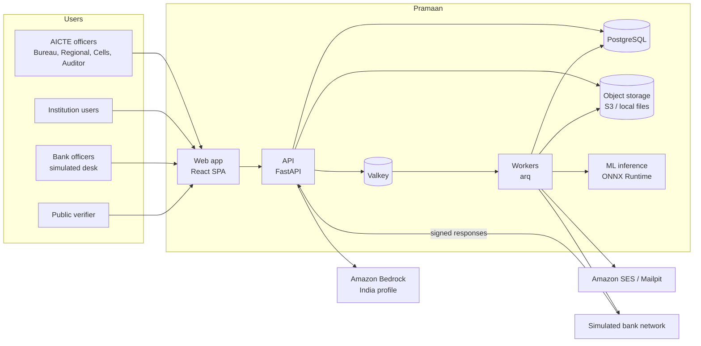
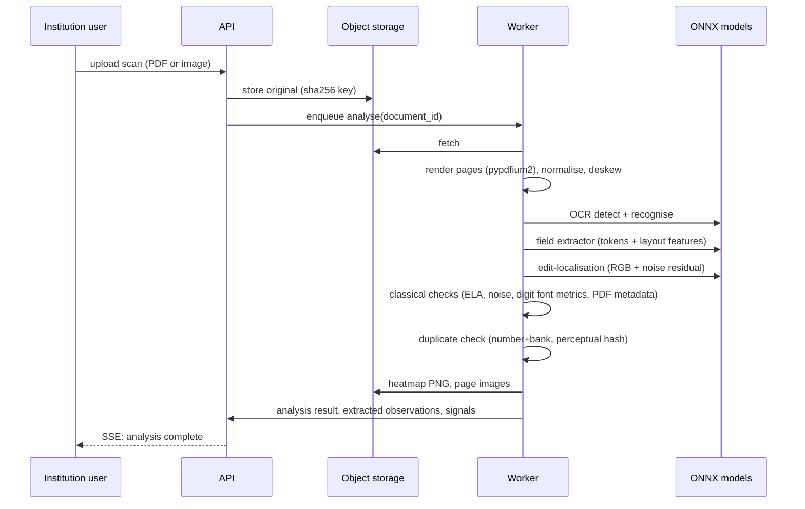
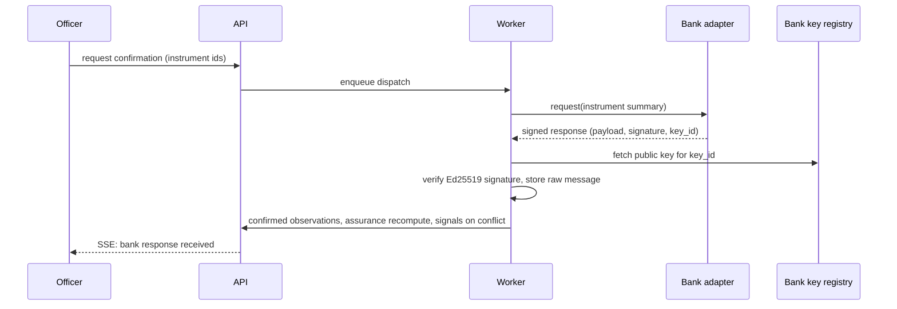
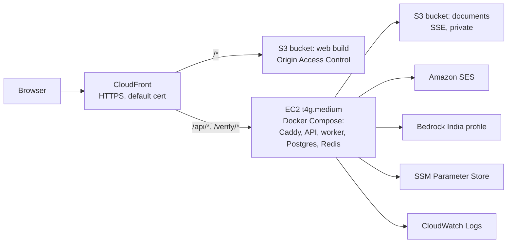

# Architecture

Status: design approved for implementation once the owner signs off (see `claude-code/HANDOFF.md`). Decisions and alternatives are recorded in `claude-code/DECISION.md`.

## 1. System context



## 2. Repository layout

```
apps/web/                 React SPA (officer app, portal, bank desk, verify page)
  src/app/                routes (TanStack Router, file-based)
  src/components/ui/      base components on Radix primitives
  src/components/signature/  AssuranceRing, ProvenanceGrid, MaturityRiver, ...
  src/features/           feature modules (portfolio, instruments, intake, releases, ...)
  src/lib/                api client, formatters (INR, dates), as-of context
  src/styles/             tokens.css, globals
services/api/             FastAPI application
  app/api/                routers (v1)
  app/domain/             pure domain logic: state machine, assurance, rules, as-of engine, penalties
  app/models/             SQLAlchemy models
  app/schemas/            Pydantic schemas
  app/services/           orchestration: documents, bank, notifications, letters, search, audit
  app/adapters/           bank adapters (simulated network, bank desk, AA design stub), storage, email, llm
  app/workers/            arq tasks and cron
  alembic/                migrations
  tests/                  unit, integration, e2e API tests
ml/                       data generation, training, evaluation, export (runs on the GPU machine)
  synth/                  portfolio generator, FDR document renderer, tamper generator
  train/                  field extractor and edit-localisation training
  eval/                   evaluation scripts that write EVALUATION results
  models/                 exported ONNX and model cards (large files via release assets, not git)
infra/                    docker compose files, Caddy config, AWS deployment scripts and templates
scripts/                  repo tooling (contrast check, demo reset, data seeding)
claude-code/              implementation instructions and logs
```

## 3. Runtime components

| Component | Technology | Responsibility |
|---|---|---|
| Web | React 19, TypeScript (strict), Vite, TanStack Router and Query, Tailwind v4, Radix, Motion, ECharts, cmdk (regions shown as a tile cartogram, D13) | All user interfaces; no business rules beyond formatting and UX validation |
| API | FastAPI, Pydantic v2, SQLAlchemy 2 (async, psycopg 3), Alembic | AuthN/Z, domain operations, queries, as-of computation, SSE events |
| Workers | arq on Redis | Document analysis, bank request dispatch and simulated responses, rule runs, reminders, letters, exports |
| Scheduler | arq cron | Daily rule run 06:00 IST, re-confirmation sweep, backups trigger |
| Database | PostgreSQL 16 | System of record; JSONB for evidence payloads |
| Cache and queue | Valkey 8 (Redis-compatible) | Job queue, short-lived caches (portfolio snapshots keyed by data and rule version), rate-limit counters |
| Object storage | S3 (deployment), local filesystem behind the same interface (development) | Documents, rendered page images, heatmaps, letters, backups; SSE-S3 or SSE-KMS |
| ML inference | ONNX Runtime CPU, RapidOCR, LightGBM, scikit-learn | OCR, field extraction, edit localisation, anomaly score |

## 4. Domain core

All rules live in `services/api/app/domain/` as pure, typed functions with no I/O. This keeps them testable and lets the forecast use exactly the production logic.

- `state_machine.py`: allowed transitions, guards (role, preconditions), resulting events.
- `assurance.py`: `assurance_level(observations, bank_messages, signals, as_of) -> Level` per `PROJECT.md` Section 3.3.
- `provenance.py`: normalisation per field (amounts to paise, dates to ISO, names case-folded and transliteration-tolerant, IFSC uppercase), comparison, character diff.
- `rules/`: one module per rule family, each with a code, a version, parameters loaded from the `rules` table, and its APH reference:
  - `demand.py` (Table 1.4 calculator, leased multiplier, exemptions)
  - `deadlines.py` (furnishing deadline, penalty windows)
  - `maturity.py` (reminder ladder, matured without application, auto-renew confirmation)
  - `escalation.py` (levels by days overdue)
  - `release.py` (eligibility checks, required documents, clearance completeness, authority type by instrument kind)
  - `penalty.py` (premature encashment, closure cases, late furnishing)
- `asof.py`: `evaluate_portfolio(instruments, events, rules, as_of)` returns statuses, due reminders, escalation levels and workload. `timeline(range, step)` returns weekly snapshots and an event stream. Results are cached in Redis by `(data_version, rules_version, as_of or range)`.

## 5. Data model

Amounts are stored as integer paise. Times are UTC in the database and shown in IST.

| Table | Key columns |
|---|---|
| `regions` | id, code, name, office_city, lat, lng |
| `institutions` | id, aicte_id, name, trust_name, region_id, state, district, premises (own, leased), ownership (private, government, aided), established_year, status, flags (jsonb: complaint_open, dispute_lien, embezzlement_noc_pending) |
| `programmes` | id, institution_id, discipline, level, intake, approved_from |
| `rules` | id, code, version, params (jsonb), aph_ref, effective_from, created_by |
| `demands` | id, institution_id, lines (jsonb), amount_paise, leased_multiplier, rule_version_id, intimated_on, due_on, status |
| `banks` | id, code, name, is_simulated, key_id, public_key |
| `instruments` | id, number, kind (joint_fdr, rpgf, rtgs), institution_id, demand_id, bank_id, branch, ifsc, amount_paise, issue_date, maturity_date, tenure_months, auto_renew, predecessor_id, status, assurance_level, owner_id, next_action, next_action_due, data_version |
| `field_observations` | id, instrument_id, field, source (declared, extracted, confirmed), value_raw, value_norm, confidence, evidence_type, evidence_id, actor_id, observed_at |
| `documents` | id, entity_type, entity_id, kind, storage_key, sha256, phash, mime, pages, uploaded_by, uploaded_at |
| `analyses` | id, document_id, status, ocr (jsonb), extraction (jsonb), forensics (jsonb), model_versions (jsonb), duration_ms, created_at |
| `signals` | id, entity_type, entity_id, code, severity, title, evidence (jsonb), source, source_version, status, resolution_note, resolved_by, resolved_at |
| `bank_requests` | id, instrument_id, kind (confirm, reconfirm, discharge), adapter, status, requested_by, requested_at |
| `bank_messages` | id, request_id, bank_id, payload (jsonb), signature, key_id, signature_valid, received_at |
| `events` | id, entity_type, entity_id, type, payload (jsonb), actor_id, occurred_at |
| `reminders` | id, instrument_id, rule_code, offset_days, channel, recipient, scheduled_for, sent_at, status |
| `escalations` | id, entity_type, entity_id, level, raised_at, resolved_at |
| `complaints` | id, institution_id, reference, cell, status, opened_at, closed_at |
| `release_cases` | id, institution_id, kind, status, eligibility (jsonb), penalty (jsonb), applied_at, authorised_by, authorised_at |
| `release_case_instruments` | release_case_id, instrument_id |
| `clearances` | id, release_case_id, cell (pgrc, vigilance, grants), status, officer_id, reason, decided_at |
| `letters` | id, kind, reference, entity_type, entity_id, recipient, storage_key, token_id, status, issued_by, issued_at |
| `users` | id, email, name, password_hash, role, region_id, institution_id, bank_id, cell, is_active |
| `notifications` | id, user_id, title, body, link, created_at, read_at |
| `outbox` | id, channel (email, sms, whatsapp), recipient, subject, body, status, provider_ref, sent_at |
| `audit_log` | id (bigserial), at, actor_id, action, entity_type, entity_id, data (jsonb), prev_hash, hash |

Indexes on `instruments(maturity_date)`, `instruments(institution_id)`, `instruments(bank_id, number)` (unique per bank), `field_observations(instrument_id, field)`, `signals(status, severity)`, `events(entity_type, entity_id, occurred_at)`.

Audit hashing: `hash = SHA-256(prev_hash || canonical_json(at, actor_id, action, entity_type, entity_id, data))`. Inserts go through one function holding an advisory lock so the chain stays linear.

## 6. API surface (v1, JSON)

All endpoints except `/auth/login`, `/public/*` and `/verify/*` require a session. Role and region checks happen in a dependency, and list queries are filtered by scope in SQL.

| Area | Endpoints |
|---|---|
| Auth | `POST /auth/login`, `POST /auth/logout`, `GET /auth/me`, `GET /auth/personas` (demo mode), `POST /auth/persona/{key}` (demo mode) |
| Portfolio | `GET /portfolio/summary?as_of`, `/portfolio/river?as_of&months`, `/portfolio/regions?as_of`, `/portfolio/action-queue?as_of`, `/portfolio/impact`, `/portfolio/timeline?from&to&step` |
| Instruments | `GET /instruments` (filters, sort, cursor), `GET /instruments/{id}`, `/instruments/{id}/observations`, `/documents`, `/bank`, `/timeline`, `/audit`; `POST /instruments/{id}/actions/{action}` for request-confirmation, return, verify, assign, correct-field, observe; `POST /instruments/bulk` (request confirmation, remind or assign up to 200, with skip reasons) |
| Institutions | `GET /institutions`, `GET /institutions/{id}`, `GET /institutions/{id}/demand` |
| Portal | `GET /portal/home`, `POST /portal/instruments` (draft), `PATCH /portal/instruments/{id}`, `POST /portal/instruments/{id}/submit`, `POST /portal/releases` |
| Documents | `POST /documents` (multipart upload), `GET /documents/{id}/pages/{n}`, `GET /documents/{id}/analysis`, `GET /documents/{id}/heatmap` |
| Signals | `GET /signals`, `POST /signals/{id}/resolve` |
| Bank desk | `GET /bank/requests`, `GET /bank/requests/{id}`, `POST /bank/requests/{id}/confirm`, `/mismatch`, `/discharge` |
| Releases | `GET /releases`, `GET /releases/{id}`, `POST /releases/{id}/clearances/{cell}`, `POST /releases/{id}/authorise`, `POST /releases/{id}/penalty/settle` |
| Alerts | `GET /alerts/reminders?rule&channel&region`, `GET /alerts/escalations?region`, `POST /monitoring/run` |
| Letters | `GET /letters`, `GET /letters/{id}/pdf`, `POST /letters/{id}/revoke` |
| Verify | `GET /verify/{token}` (public) |
| Search | `POST /search/interpret` (Bedrock, returns filter object), `GET /search/suggest` |
| Reports | `GET /reports/{code}?params&format=csv|pdf` |
| Audit | `GET /audit`, `POST /audit/verify` |
| Admin | `GET/POST /admin/rules`, `GET/POST /admin/users` |
| Events | Not built: analysis is synchronous and notifications poll (DECISION D31) |
| Demo | `POST /demo/reset`, `POST /demo/scenario/{code}` (demo mode only) |
| Health | `GET /healthz` (liveness), `GET /readyz` (database, Redis, storage, models loaded) |

OpenAPI is generated by FastAPI; the web client types are generated from it (`openapi-typescript`) so the contract cannot drift.

## 7. Document intelligence pipeline



Every analysis stores model names and versions so any signal can be traced to the exact model that raised it.

## 8. Bank confirmation flow



Adapters: `SimulatedBankNetwork` (automatic, seeded outcomes and latency), `BankDesk` (human at the simulated bank surface), `AccountAggregatorAdapter` (interface and mapping only). The bank's private keys exist only inside the simulator module and its separate key store, never in the main key registry.

## 9. Security architecture (summary)

- Sessions: signed, httpOnly, Secure, SameSite=Lax cookie; 8-hour idle timeout for officers. CSRF token header on state-changing requests.
- Passwords: Argon2id. Sign-in rate limited per IP and per account.
- Authorisation: role plus scope (region, institution, bank, cell) enforced in API dependencies and in SQL filters; deny by default; tests for every role and endpoint pair that matters.
- Documents: private bucket, server-side encryption, access only through the API or short-lived pre-signed URLs; every view is audited.
- Letters and bank messages: Ed25519 signatures; public keys published at `/.well-known/pramaan-keys.json`.
- LLM: only the query text and the filter schema are sent; no personal data or documents; responses validated against the schema before use.
- Secrets: environment variables locally, AWS Systems Manager Parameter Store (SecureString) in deployment; never in git.

Details in `SECURITY.md`.

## 10. Deployment topology (AWS, ap-south-1)



- EC2 accepts HTTP only from the CloudFront origin-facing managed prefix list, and requires a secret origin header set by CloudFront.
- Instance role grants least-privilege access to the two buckets, SES send, Bedrock invoke for the chosen profiles, SSM read for `/pramaan/*`, and CloudWatch Logs.
- Nightly `pg_dump` to the documents bucket under `backups/` with a 14-day lifecycle rule.
- Estimated monthly cost (on-demand prices checked 24 October 2026): t4g.medium $0.0224 per hour (about $16.4), 30 GB gp3 (about $2.7), S3 and requests (under $1), CloudFront and SES within free tiers at demo volume, Bedrock (about $1 to $3). Total about $21 to $24 per month. Details in `DEPLOYMENT.md`.

## 11. Observability

- JSON logs with `request_id`, `user_id`, `role`, route, latency; shipped to CloudWatch Logs by the Docker awslogs driver.
- `/healthz` and `/readyz`; Docker health checks restart unhealthy containers.
- Worker job metrics (queued, running, failed, duration) exposed on an admin page.
- Frontend errors reported to the API (`POST /client-errors`) with the request ID.

## 12. Scalability path (documented, not built)

Move Postgres to RDS, the API and workers to ECS Fargate services behind an ALB, documents unchanged on S3, Redis to ElastiCache. The code needs no changes beyond configuration because all state is external to the containers.
